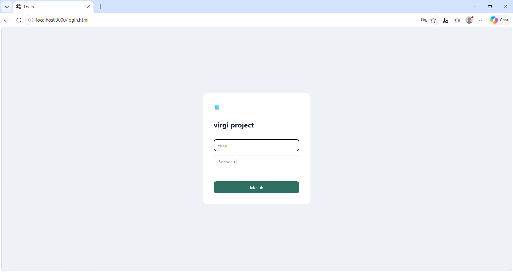
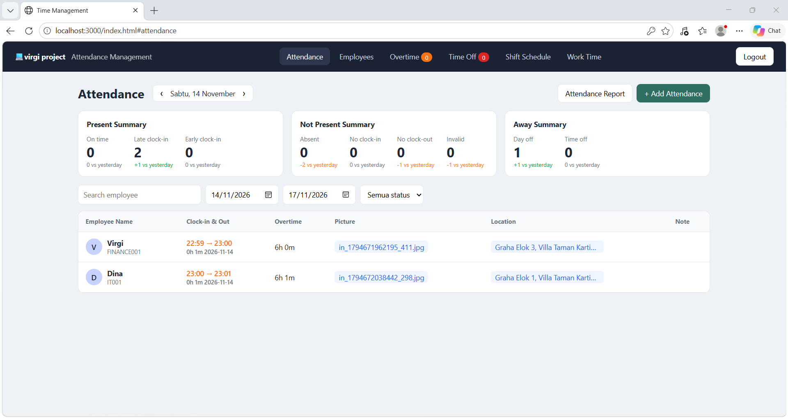
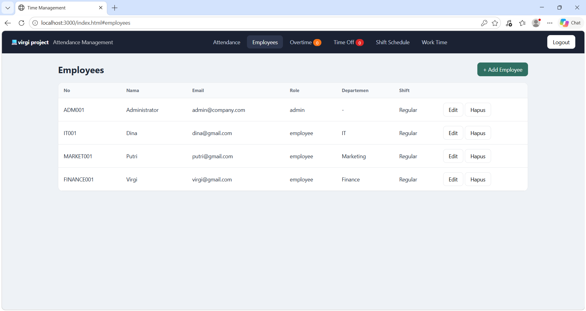
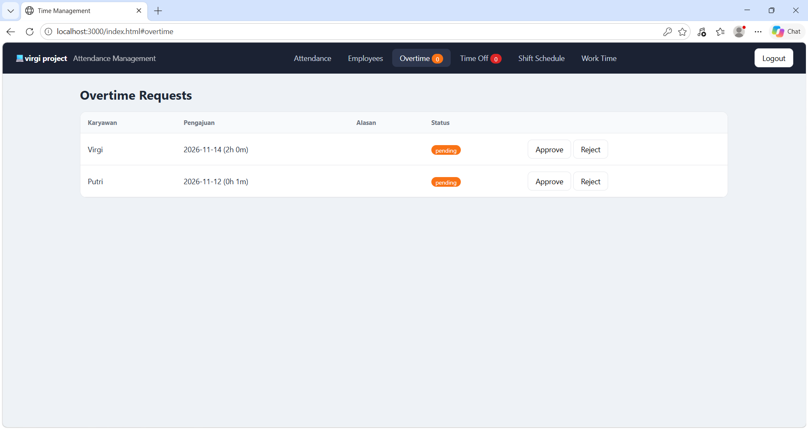
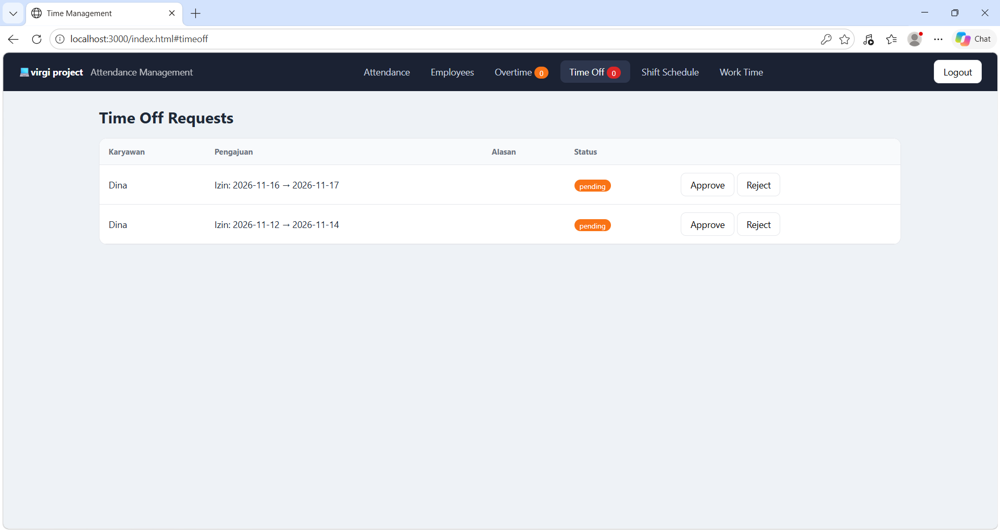
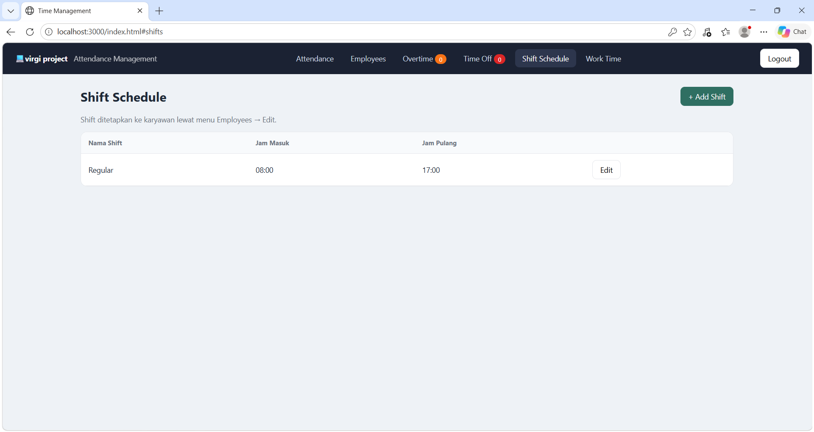
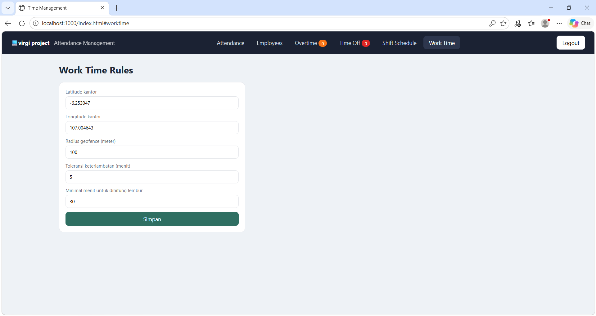
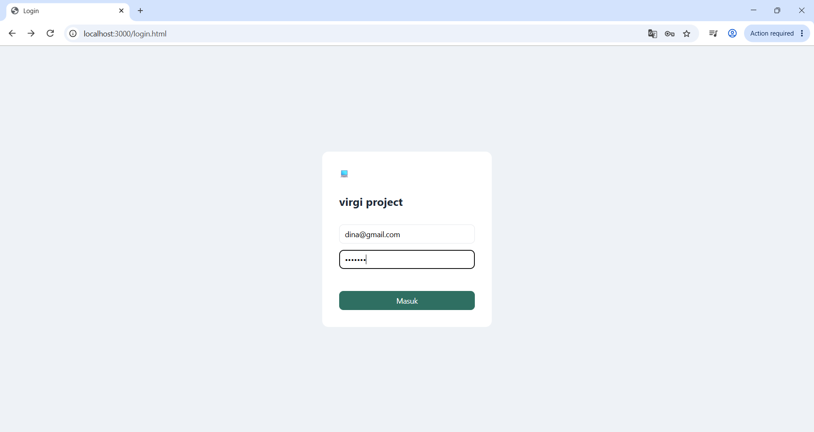
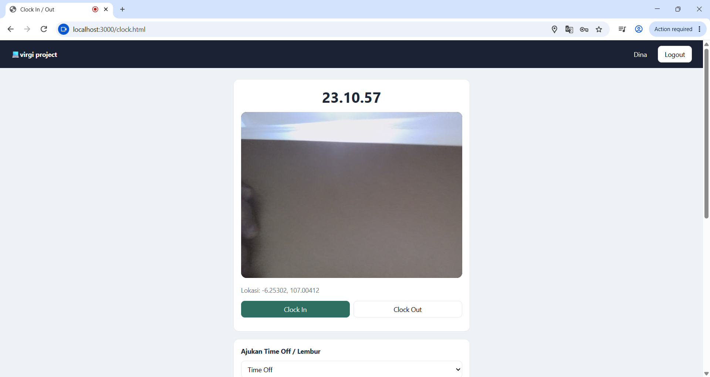
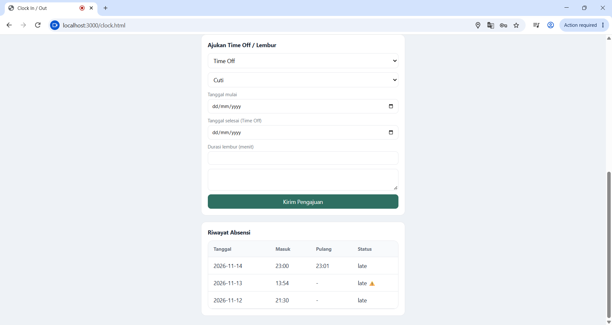

# employee-attendance-system

Aplikasi web manajemen absensi karyawan dengan selfie, geolokasi (geofencing), perhitungan status kehadiran otomatis, pengajuan cuti/lembur, dan laporan.

### 1. Identitas Proyek

Nama aplikasi : Employee Attendance Management System
Pengembang : Virgidina Kamilya Putri Herliani
Repository : https://github.com/virgikamilya-sudo/employee-attendance-system
Tahun : 2026

### 2. Latar Belakang

Pencatatan kehadiran secara manual (buku tamu, tanda tangan, atau mesin fingerprint yang terpisah) memiliki banyak kelemahan: rawan manipulasi (titip absen), sulit direkap, tidak mendukung karyawan yang bekerja di luar kantor, dan membutuhkan waktu lama bagi HRD untuk menyusun laporan bulanan.

Perangkat yang dimiliki hampir semua karyawan, yaitu ponsel dengan kamera dan GPS, dapat dimanfaatkan sebagai alat absensi. Dengan memadukan foto selfie, koordinat lokasi, dan validasi radius kantor, bukti kehadiran menjadi lebih kuat dan proses rekap dapat diotomatisasi.

Proyek ini dibuat untuk menghadirkan sistem absensi berbasis web yang sederhana, ringan, dan dapat dijalankan tanpa biaya infrastruktur yang besar.

### 3. Tujuan Aplikasi

1.  Mencatat kehadiran karyawan (clock-in/clock-out) secara digital dengan bukti foto dan lokasi.
2.  Menentukan status kehadiran (tepat waktu, terlambat, lebih awal, tidak valid) dan lembur secara otomatis.
3.  Memberikan ringkasan kehadiran harian kepada admin/HR beserta perbandingan dengan hari sebelumnya.
4.  Mengelola pengajuan cuti/izin dan lembur dengan alur persetujuan (approval).
5.  Mengurangi kecurangan absensi melalui geofencing dan bukti selfie.

### 4. Analisis Kebutuhan

4.1 Kebutuhan Fungsional

- Sistem menyediakan login dengan email dan password, membedakan hak akses (admin, hr, employee)
- Employee dapat melakukan clock-in dengan selfie dan koordinat GPS, clock out, mengajukan time off dan overtime, melihat riwayat absensi miliknya.
- Admin/HR dapat menambah, mengubah, dan menonaktifkan data karyawan, melihat ringkasan kehadiran harian, menyetujui atau menolak pengajuan, mengelola shift dan aturan jam kerja.
  4.2 Kebutuhan Non-Fungsional
- Keamanan : Password disimpan sebagai hash bcrypt, seluruh endpoint (kecuali login) dilindungi token JWT berkedaluwarsa 12 jam.
- Privasi : Foto selfie hanya dapat dibuka oleh admin/HR yang login.
- Pemeliharaan : Kode terpisah per modul (routes, lib, middleware)

### 5. Fitur Aplikasi

Portal Karyawan :

- Login dan logout
- Clock-in/ clock-out dengan selfie kamera dan GPS
- Riwayat absensi 31 hari terakhir
- Pengajuan Time off (cuti, sakit, izin) dan overtime.

Dashboard Admin/HR

- Attendance: navigasi tanggal, summary cards (Present, Not Present, Away), tabel absensi (nama, jam masuk/pulang, lembur, foto, lokasi, catatan).
- Add Attendance: input absensi manual
- Attendance Report: ekspor CSV
- Employees: CRUD karyawan, penetapan role dan shift
- Overtime dan Time Off: daftar pengajuan, approve/reject, badge jumlah pending di navbar
- Shift Schedule: kelola shift (nama, jam masuk, jam pulang)
- Work Time: koordinat kantor, radius geofence, toleransi keterlambatan, batas minimal lembur.

### 6.

### 7. Tools

    - HTML5 : membuat struktur halaman web
    - CSS : mengatur tampilan dan ui/ux
    - JavaScript : mengelola interaksi dan logika aplikasi
    - Node.js : menjalankan backend
    - Express : routing dan middleware REST API
    - SQLite : penyimpanan data dalam satu file
    - better-sqlite3 : Akses SQLite sinkron dan cepat
    - jsonwebtoken, bcryptjs : Token JWT dan hash password
    - Browser api getUserMedia, Geolocation, Canvas : Kamera, GPS, pengambilan foto
    -     OpenStreetMap Nominatim : Mengubah koordinat menjadi alamat

### 8. Struktur Folder

    attendance-system/
    ├── lib/
    │ └── helpers.js # Logika bisnis: Haversine, status, lembur, simpan foto, geocoding
    ├── middleware/
    │ └── auth.js # Verifikasi JWT dan pembatasan role
    ├── public/ # Frontend statis
    │ ├── css/style.css # Seluruh gaya antarmuka
    │ ├── js/
    │ │ ├── api.js # Wrapper fetch + helper umum
    │ │ ├── admin.js # Logika dashboard admin/HR
    │ │ └── clock.js # Logika portal karyawan (kamera, GPS)
    │ ├── login.html
    │ ├── index.html # Dashboard admin/HR
    │ └── clock.html # Portal karyawan
    ├── routes/ # Endpoint REST API
    │ ├── auth.js # Login
    │ ├── employees.js # CRUD karyawan
    │ ├── attendance.js # Clock-in/out, summary, list, manual, export
    │ ├── requests.js # Time off dan overtime
    │ └── config.js # Shift dan pengaturan jam kerja
    ├── uploads/ # Foto selfie hasil clock-in/out (tidak di-commit)
    ├── db.js # Koneksi SQLite, pembuatan tabel, data awal (seed)
    ├── server.js # Konfigurasi Express (middleware dan routing)
    ├── package.json
    ├── .env # Rahasia lokal (tidak di-commit)
    ├── .gitignore
    └── attendance.db # File database, dibuat otomatis (tidak di-commit)

### 9. Testing

### 10. Instalasi

- Clone repository :git clone https://github.com/virgikamilya-sudo/employe-attendance-system.git
  cd employe-attendance-system
- Install dependensi
  npm install
- Jalankan (mode development, auto-reload)
  npm run dev
- mode biasa
  npm start

### 11. Kesimpulan

    Aplikasi Employee Attendance System berhasil dikembangkan sebagai aplikasi web dengan dua antarmuka: portal karyawan untuk absensi berbasis selfie dan GPS, serta dashboard admin/HR untuk monitoring, persetujuan, dan pelaporan. Fitur utama yang terimplementasi mencakup autentikasi berbasis role, geofencing, status kehadiran dan lembur otomatis, summary harian dengan perbandingan hari sebelumnya, pengajuan time off/overtime dengan approval, manajemen shift, pengaturan jam kerja, ekspor CSV, dan audit log.

### 12. Lampiran

### 12.1 Dashboard Admin/HR

**a. Halaman Login**

**b. Halaman Attendance**

**c. Halaman Employees**

**d. Halaman Overtime**

**e. Halaman Time Off**

**f. Halaman Shift Schedule**

**g. Halaman Work Time**

### 12.2 Dashboard Employee

**a. Halaman Login**

**b. Halaman Clock In / Clock Out**

**c. Pengajuan Time Off / Overtime**

**d. Riwayat Absensi**

